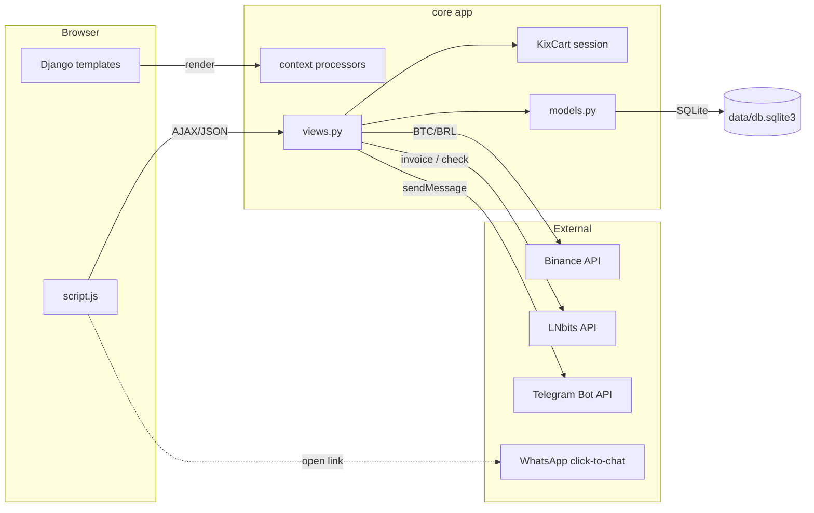
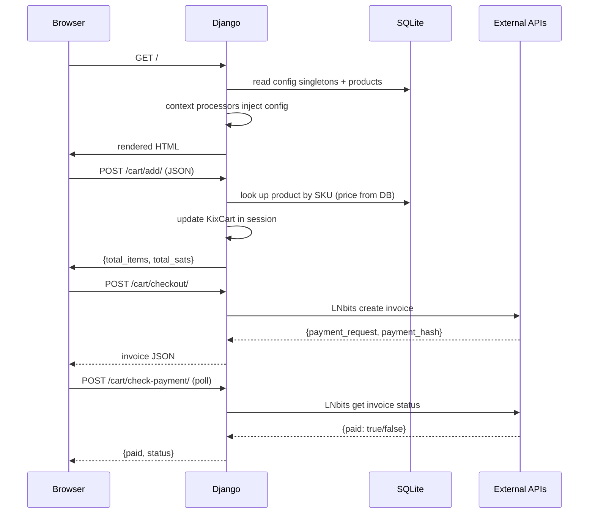

# Architecture

> 🇧🇷 [Português](pt-BR/ARQUITETURA.md)

This document explains how the KIX Store is organized, how data flows through it, and
how it maps onto the KIX Protocol. It assumes you know Django basics (apps, models,
views, templates, middleware) and are comfortable reading Python and JavaScript.

## 1. High-level overview

KIX Store is a **single Django app** named `core`. There is no separate front-end
build: server-rendered Django templates (`templates/`) are progressively enhanced with
a small amount of vanilla JavaScript (`core/static/js/script.js`) that talks to JSON
endpoints for cart and checkout actions.



The store is deliberately thin: it does **not** run a Lightning node. It delegates
settlement to an **LNbits** instance over HTTP, which is exactly the merchant/PDV
position the KIX Protocol describes (see [KIX_PROTOCOL.md](KIX_PROTOCOL.md)).

## 2. Directory layout

```
supermercado_kix/
├── core/                      # the single Django app
│   ├── admin.py               # admin registrations + singleton guards
│   ├── cart.py                # KixCart (session cart) — ACTIVE implementation
│   ├── core.py                # older duplicate KixCart (superseded)
│   ├── context_processors.py  # injects config into every template
│   ├── forms.py               # ProfileForm
│   ├── models.py              # all models
│   ├── services/
│   │   └── executor.py        # Telegram notification client
│   ├── settings.py            # Django settings (reads .env)
│   ├── static/                # css/js/images served by WhiteNoise
│   ├── templates/core/        # editar_perfil.html
│   ├── urls.py                # URL conf
│   ├── views.py               # all views
│   └── migrations/            # 24 migrations (schema history)
├── templates/                 # project-level templates (base, index, ...)
├── data/                      # SQLite database (mounted volume in Docker)
├── media/                     # uploaded images (products, hero, site)
├── staticfiles/               # collectstatic output (production)
├── Dockerfile
├── docker-compose.yml
├── deploy.sh                  # one-shot deployment script
├── requirements.txt
└── .env                       # secrets/config (git-ignored)
```

### Note: two `KixCart` classes

The repository contains two cart implementations:

- `core/cart.py` — the **active** one. `views.py` imports `from .cart import KixCart`.
  It adds `get_items()`, `get_summary()`, `__iter__()`, and `remove(quantity=...)`.
- `core/core.py` — an older, simpler copy that is no longer imported by the app.

If you modify cart behavior, edit `core/cart.py`; `core/core.py` can be ignored (or
deleted) as dead code.

## 3. Request lifecycle



## 4. The cart

The cart lives entirely in the user's **session** under the key `kix_cart`. It maps a
product's SKU to a small dict:

```python
{
  "<sku>": {"name": "...", "price_sats": 12345, "quantity": 2},
  ...
}
```

Important design choice: `cart_add` **ignores** any price/name sent by the browser. It
re-reads the product from the database by SKU, so a malicious client cannot change
prices in transit (see `views.py:cart_add`). Quantities are the only client-controlled
input that affects totals.

## 5. Pricing model

- Products store their price as an integer in **satoshis** (`Produto.preco_sats`).
- The Bitcoin/BRL reference rate is fetched from the **Binance** public ticker
  (`BTCBRL`) and cached in `CotacaoBitcoin` for up to 24 hours.
- `Produto.preco_brl` computes the fiat *reference* price:
  `preco_sats × (BTC/BRL ÷ 100_000_000)`, with a hardcoded fallback of
  `0.005 BRL/sat` when no quote exists yet.
- `Produto.preco_pix_estatal` = `preco_brl × 1.1` (the PIX path adds a 10% fee by
  default; the rate is configurable in `ConfiguracaoPix`).

This dual pricing is the economic lever: paying natively in sats is always cheaper
than the fiat PIX route.

## 6. Payment flows

### 6.1 Native KIX (Lightning)

1. The customer confirms their delivery data (loaded from `/api/user-profile/`).
2. `POST /cart/checkout/` computes the cart total in sats and calls LNbits:

   ```json
   {"out": false, "amount": <total_sats>, "memo": "...", "unit": "sat"}
   ```

3. LNbits returns a BOLT 11 `payment_request` and `payment_hash`.
4. The browser renders the invoice as a QR code (client-side `qrcode-generator`) and
   polls `POST /cart/check-payment/` every 3 seconds (up to ~60 attempts).
5. On `paid: true`, the cart is cleared.

### 6.2 PIX (fiat fallback)

The PIX checkout is **computed entirely client-side** in `script.js`:

- It reads the cart total (sats) from the header and the BTC/BRL rate from a hidden
  input (`#btc-price-hidden`, injected by the template).
- It applies the fee: `total_sats × 1.10`, converts to BRL
  (`sats ÷ 1e8 × btc_price`), and renders a PIX QR code (via `qrserver.com`) using the
  PIX key from `ConfiguracaoPix`.

> Note: the PIX QR data is generated with a hardcoded key in one code path of
> `script.js` (`qrcode` + `'SUA_CHAVE_PIX_AQUI'`) while the template also renders a
> `qrserver.com` image with `pix_config.chave_pix`. The admin-configured key is the
> source of truth; the hardcoded string is a leftover to review if you rely on the
> client-generated QR.

## 7. Configuration singletons

Several admin-editable models are **singletons**: there is exactly one row (`pk=1`) and
the admin prevents creating or deleting additional rows. They follow a shared pattern:

```python
def save(self, *args, **kwargs):
    self.pk = 1
    super().save(*args, **kwargs)

@classmethod
def get_solo(cls):
    obj, created = cls.objects.get_or_create(pk=1)
    return obj
```

`admin.py` mirrors this with `has_add_permission()`/`has_delete_permission()` guards.

The singletons are:

| Model | Purpose |
|-------|---------|
| `SiteConfig` | logo, store name, meta title, badge, colors, banner texts/colors, button texts |
| `ConfiguracaoPix` | PIX key, payee name, fee label, fee %, modal instructions |
| `ConfiguracaoTelegram` | Telegram creds fallback + contact form texts |
| `ConfiguracaoRodape` | company data (phones, e-mail, address, social links) |
| `ConfiguracaoWhatsApp` | floating button (active, number, default message) |

They are exposed to all templates through **context processors**
(`core/context_processors.py`), so `base.html` can render them without each view
building its own context.

## 8. External integrations

| Service | Endpoint | Used for | Credential |
|---------|----------|----------|-----------|
| Binance | `GET /api/v3/ticker/price?symbol=BTCBRL` | BTC/BRL price | none (public) |
| LNbits | `POST <LNBITS_URL>` and `GET <LNBITS_URL>/<hash>` | create/check invoice | `LNBITS_API_KEY` |
| Telegram | `POST https://api.telegram.org/bot<token>/sendMessage` | contact + service notifications | `TELEGRAM_BOT_TOKEN`, `TELEGRAM_CHAT_ID` |
| WhatsApp | `https://api.whatsapp.com/send?phone=…&text=…` | click-to-chat (no API key) | number |

Telegram credentials resolve in this order (see `services/executor.py`):
`.env` values first, then the `ConfiguracaoTelegram` admin singleton.

## 9. Known quirks & review notes

These are observations from reading the code — **not** bugs you must fix now, but worth
knowing if you work on these areas:

- **Category URL collision** — `core/urls.py` defines two patterns that both resolve to
  the name `categoria_detalhe`:
  - `categoria/<str:nome>/` → `views.categoria_detalhe` (filters `Produto` by
    `categoria__slug`).
  - `categoria/<slug:slug>/` → `views.detalhe_categoria` (looks up `CategoriaCard`).
  Because Django matches patterns in order and `str` matches any single path segment,
  the first pattern wins; `detalhe_categoria` is effectively unreachable for these
  URLs. The two views also model "category" differently (`Categoria` vs
  `CategoriaCard`).
- **Duplicate cart class** — see [Section 2](#note-two-kixcart-classes).
- **Legacy DB file** — `settings.py` points at `data/db.sqlite3`, but a `db.sqlite3`
  also exists at the repo root. Only `data/db.sqlite3` is used at runtime.
- **Two logging dirs** — `logs/` and `logs.root-owned/` exist; `settings.py` uses
  `logs/app.log` and falls back to console-only if the directory is not writable.
- **`produto_detalhe` FK assumption** — `detalhe_categoria` filters
  `Produto.objects.filter(categoria=categoria)` where `categoria` is a `CategoriaCard`;
  because `Produto.categoria` is a FK to `Categoria` (not `CategoriaCard`), this view
  would raise on evaluation. It is currently dead code (see the URL collision above).

## 10. Where to change things

| Want to… | Edit |
|----------|------|
| Add a product field | `core/models.py` → `Produto`, then `makemigrations` |
| Change checkout/invoice logic | `core/views.py` (`generate_lightning_invoice`) |
| Change cart behavior | `core/cart.py` |
| Add an admin section | `core/admin.py` |
| Change storefront styling | `core/static/css/style.css` and `templates/base.html` |
| Add a notification channel | `core/services/executor.py` |
