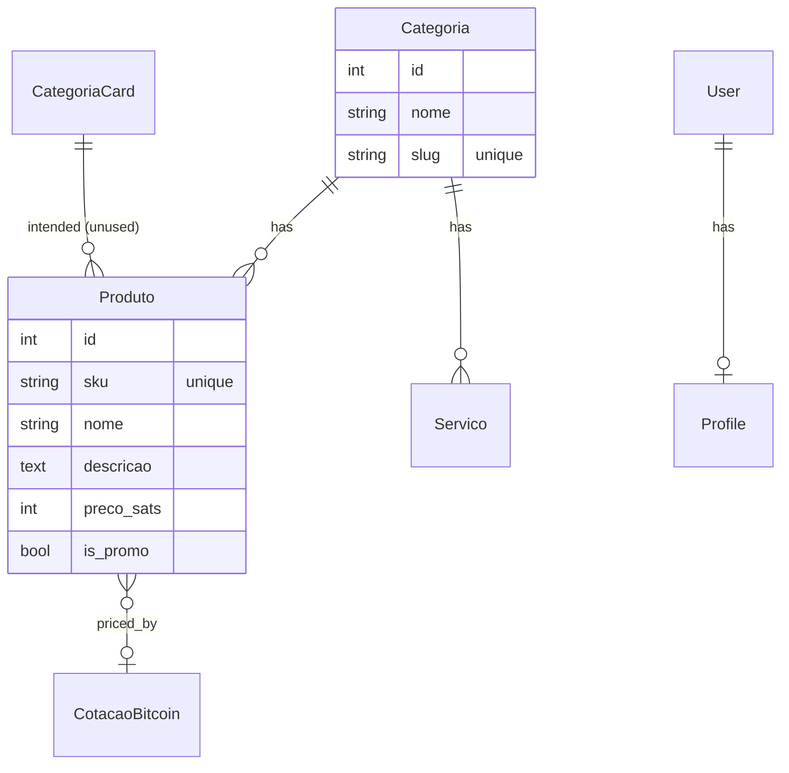

# Data Model

> 🇧🇷 [Português](pt-BR/MODELO_DE_DADOS.md)

All models live in `core/models.py`. This page describes each model, its key fields,
and the singleton pattern used for site configuration.

## ER overview

> The `CategoriaCard → Produto` edge is **intended but broken**: `detalhe_categoria`
> tries to filter `Produto` by a `CategoriaCard`, but `Produto.categoria` is a FK to
> `Categoria`. See Architecture §9.

## Catalogue models

### `Categoria`
- `nome` (CharField)
- `slug` (SlugField, unique)

Product categories; the slug drives `/categoria/<slug>/` filtering.

### `MacroCategoria`
- `nome`, `slug` (unique), `ordem`, `ativo`

Macro-categories "shown on the main storefront". Currently defined but not rendered by
`index.html` (the template uses `CategoriaCard` for tiles instead).

### `CategoriaCard`
- `titulo`, `slug` (unique), `imagem_fundo` (ImageField), `ordem`

The actual category tiles rendered on the home page.

### `Produto`
- `sku` (unique, nullable) — used as the cart key and in the detail URL
- `nome`, `descricao`
- `categoria` (FK → `Categoria`, SET_NULL)
- `icone` (emoji fallback when no image)
- `preco_sats` (IntegerField) — **the canonical price**, in satoshis
- `imagem` (ImageField, `produtos/`)
- `is_promo` — include in "Ofertas Rápidas" (home, max 4)

Computed properties:

- `preco_brl` — reference fiat price from the latest `CotacaoBitcoin`, fallback
  `0.005 BRL/sat`.
- `preco_pix_estatal` — `preco_brl × 1.1`.

### `CotacaoBitcoin`
- `preco_brl` (Decimal), `ultima_atualizacao` (DateTime)

Stores the last BTC/BRL quote. Refreshed by `views.home` when missing or older than
24 h; also read by `context_processors.btc_context`.

### `Servico`
- `nome`, `descricao`, `categoria` (FK, nullable), `icone`, `imagem`, `is_promo`
- `whatsapp_ativo`, `telegram_ativo` — which contact channels the card offers
- `mensagem_padrao` — pre-filled interest message

Concierge/advisory cards. They do **not** enter the cart; interest is sent via
Telegram/WhatsApp.

## Auth model

### `Profile`
- `user` (OneToOne → `auth.User`, CASCADE, `related_name='profile'`)
- `endereco` (Text), `telefone` (WhatsApp)

Created automatically by `post_save` signals on `User` (see `models.py`). Edited via
`ProfileForm` at `/perfil/editar/`.

## Configuration singletons

Each of the following has exactly one row (`pk=1`), enforced by `save()`,
`get_solo()`, and admin `has_add_permission()`/`has_delete_permission()`.

### `HomeConfig`
- `titulo_hero`, `subtitulo_hero`, `imagem_hero`, `ativo`

Home hero banner.

### `SiteConfig`
The largest config object. Groups:
- **SEO/naming** — `logo`, `meta_title`, `nome_loja`
- **Badge** — `badge_ecossistema`, `badge_bg_color`, `badge_text_color`
- **Header** — `header_bg_color`, `header_text_color`, `sats_color`
- **Cart buttons** — clear/pay texts and colors
- **Auth** — greeting, edit/logout/login texts and colors
- **Banner** — `exibir_banner`, `exibir_cotacao`, banner texts and colors

### `ConfiguracaoPix`
- `chave_pix`, `nome_titular`, `rotulo_taxa_pix`, `taxa_estatal_percentual` (default 10),
  `instrucao_pagamento`

### `ConfiguracaoTelegram`
- `bot_token`, `chat_id` (fallback to `.env`), `ativo`
- `titulo_form`, `texto_botao`, `mensagem_sucesso`, `mensagem_erro`

### `ConfiguracaoRodape`
- `descricao_curta`, `telefone_principal`, `outros_telefones`, `email_contato`,
  `endereco`, `site_principal`
- `facebook_url`, `instagram_url`, `youtube_url`, `x_url`

### `ConfiguracaoWhatsApp`
- `ativo`, `numero`, `mensagem_padrao` (fallback to `.env` per-field)

## Migration history

`core/migrations/` contains 24 migrations. The sequence is linear and reflects the
feature history: initial `Produto` → images/emoji → SKU/promo → `CotacaoBitcoin` →
`Categoria`/`Profile` → `HomeConfig` → `MacroCategoria` → `SiteConfig` (multiple
color/text additions) → `CategoriaCard` → `ConfiguracaoPix` → `ConfiguracaoRodape` +
`ConfiguracaoTelegram` → `ConfiguracaoWhatsApp` → `Servico` (and its later
refactor from a single `canal` to `whatsapp_ativo`/`telegram_ativo`).
