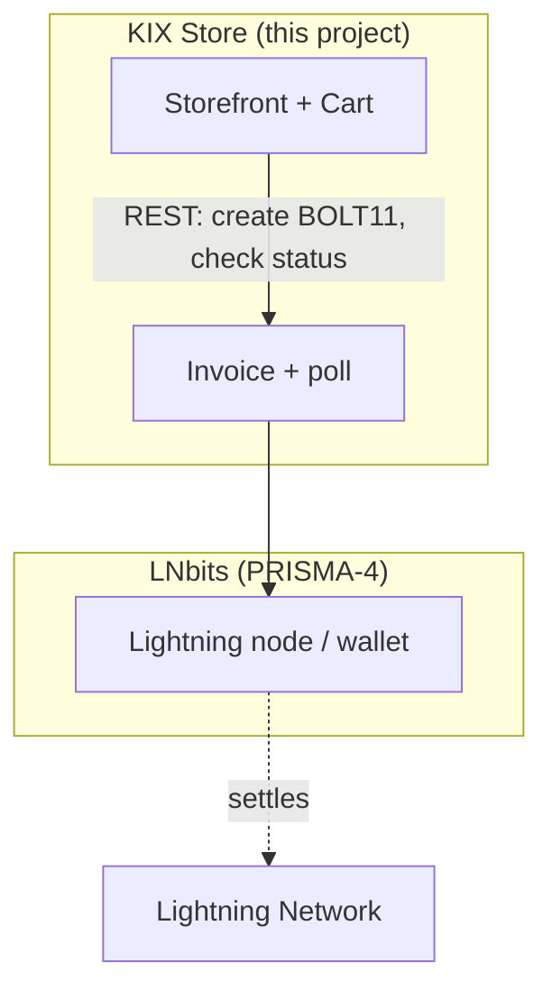

# KIX Protocol Context

> 🇧🇷 [Português](pt-BR/PROTOCOLO_KIX.md)

The KIX Store is a merchant front-end built on top of the
[KIX Protocol](https://github.com/Hexarcs/KIX-PROTOCOL). This page explains what the
protocol is and how this project maps onto it. It is a summary of the upstream
specification — always treat the protocol repo as authoritative.

## What the KIX Protocol is

KIX is an open specification that reduces the burden of running Lightning Network
infrastructure by splitting it into standardized, modular layers. Its organizing
framework is **P.R.I.S.M.A.** — *Protocol Routing & Infrastructure Specification for
Merchant Applications* — which divides the stack into six modules:

| Layer | Name | Responsibility |
|-------|------|----------------|
| PRISMA-1 | Execution Infrastructure & Host Profiles | hardware/OS, resource tiers |
| PRISMA-2 | Topology, Deployment & Network Exposure | Docker/Podman/bare-metal, Tor/tunnel/clearnet |
| PRISMA-3 | Chain Source & Backend Sync | Bitcoin Core / Neutrino / Esplora / RPC |
| PRISMA-4 | Lightning Engine Abstraction | LND, CLN, Eclair, Phoenixd, **LNbits**, LDK, NWC |
| PRISMA-5 | Multi-Format Invoice Encoders | BOLT 11, BOLT 12, BIP 21, LNURL-Pay, Cashu |
| PRISMA-6 | Invoice Execution Profiles | HEAVY / HYBRID / LIGHT execution |

A second concept, **S.H.A.R.D.** (*Software Hardware Automated Routing Division*),
defines the physical/operational unit of a host (embedded → edge → desktop → cloud).

At the top of the protocol's architecture sits the **POS / wallet layer** (PDV,
LNbits, Nostr Wallet Connect, PWAs, dashboards), which talks REST/WebSocket/MQTT down
through PRISMA-6 → PRISMA-5 → PRISMA-4 → PRISMA-3 → PRISMA-2 → PRISMA-1.

## Where the KIX Store sits

This Django app **is that top POS/merchant layer**. It deliberately does not run a
node; it consumes a Lightning engine over HTTP:

Mapping of this project's components onto PRISMA:

| KIX Store component | PRISMA layer | Detail |
|---------------------|--------------|--------|
| `generate_lightning_invoice` (LNbits call) | PRISMA-4 (engine abstraction) | delegates settlement to LNbits |
| BOLT 11 `payment_request` + QR | PRISMA-5 (invoice encoding) | Lightning invoice format |
| Browser-only polling/QR rendering | PRISMA-6 (**LIGHT** profile) | the storefront stays thin; the node does the heavy work |
| Docker / Compose / bare-metal | PRISMA-2 | deployment & exposure |
| `LNBITS_URL` / `LNBITS_API_KEY` | PRISMA-2/PRISMA-4 config | engine endpoint + auth |

## The economic design (sats vs. PIX)

The store encodes the protocol's incentive to settle natively over Lightning:

- **Native KIX** — products are priced in **sats**, settled via a Lightning invoice.
  This is the cheapest and default path.
- **PIX estatal** — the fiat alternative priced from the BTC/BRL rate plus a
  configurable "state processing fee" (`taxa_estatal_percentual`, default `+10%`).

The 10% spread is a deliberate price signal: it makes the Lightning path cheaper and
demonstrates the "economia real" (real economy) thesis — settling in sats avoids the
friction/cost of the fiat rail. The exact fee and its label are editable in
`ConfiguracaoPix`, so a merchant can tune (or neutralize) the incentive.

## Terminology used by the storefront

| Term | Meaning in this project |
|------|-------------------------|
| **sats / satoshis** | 1 sat = 1/100,000,000 BTC; the store's base price unit |
| **Lightning Network** | layer-2 Bitcoin settlement used by the native checkout |
| **BOLT 11 invoice** | the `payment_request` string the customer scans/pays |
| **LNbits** | the Lightning engine/wallet the store calls over HTTP |
| **PIX estatal** | Brazil's fiat instant-payment rail, used as the fiat fallback |
| **taxa de processamento fiat** | the configurable fee added to the PIX path |

## Further reading

- [KIX Protocol repository](https://github.com/Hexarcs/KIX-PROTOCOL) — the
  authoritative spec (PDFs in Portuguese and English).
- [LNbits API](https://legend.lnbits.com/docs) — the engine this store integrates with.
- [BOLT 11](https://github.com/lightning/bolts/blob/master/11-payment-encoding.md) —
  the invoice format used at checkout.
