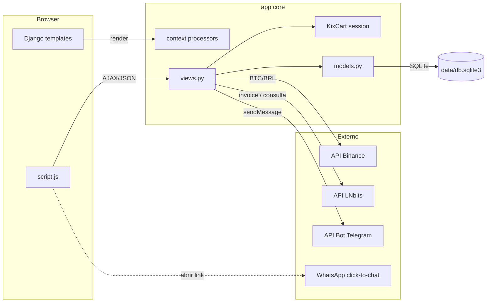
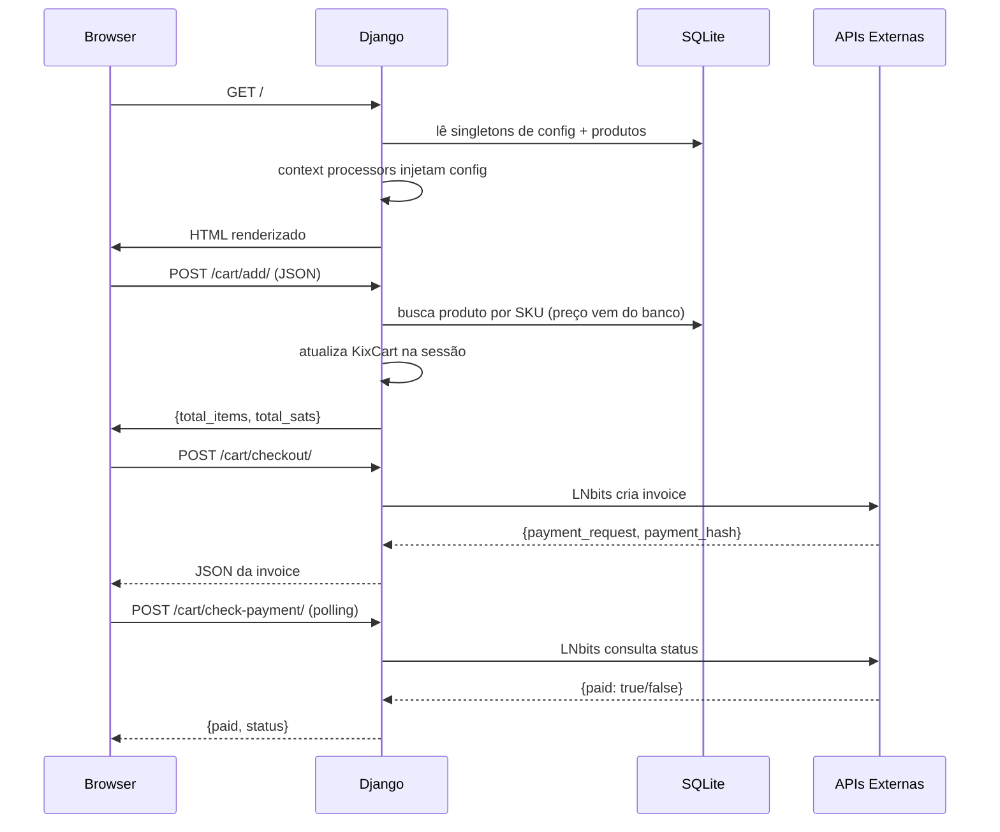

# Arquitetura

> 🇺🇸 [English](../ARCHITECTURE.md)

Este documento explica como a KIX Store é organizada, como os dados fluem por ela e
como ela se encaixa no Protocolo KIX. Pressupõe familiaridade básica com Django (apps,
models, views, templates, middleware) e leitura de Python e JavaScript.

## 1. Visão geral

A KIX Store é uma **única app Django** chamada `core`. Não há build de front-end
separado: templates Django renderizados no servidor (`templates/`) são aprimorados com
uma pequena camada de JavaScript vanilla (`core/static/js/script.js`) que conversa com
endpoints JSON para ações de carrinho e checkout.



A loja é deliberadamente enxuta: ela **não** roda um nó Lightning. Delega a liquidação
a uma instância **LNbits** via HTTP — exatamente a posição de comerciante/PDV descrita
pelo Protocolo KIX (veja [PROTOCOLO_KIX.md](PROTOCOLO_KIX.md)).

## 2. Estrutura de diretórios

```
supermercado_kix/
├── core/                      # a única app Django
│   ├── admin.py               # registros do admin + guardas de singleton
│   ├── cart.py                # KixCart (carrinho de sessão) — implementação ATIVA
│   ├── core.py                # cópia antiga do KixCart (obsoleta)
│   ├── context_processors.py  # injeta config em todos os templates
│   ├── forms.py               # ProfileForm
│   ├── models.py              # todos os models
│   ├── services/
│   │   └── executor.py        # cliente de notificação Telegram
│   ├── settings.py            # configurações Django (lê .env)
│   ├── static/                # css/js/imagens servidas pelo WhiteNoise
│   ├── templates/core/        # editar_perfil.html
│   ├── urls.py                # URL conf
│   ├── views.py               # todas as views
│   └── migrations/            # 24 migrações (histórico do schema)
├── templates/                 # templates no nível do projeto (base, index, ...)
├── data/                      # banco SQLite (volume montado no Docker)
├── media/                     # imagens enviadas (produtos, hero, site)
├── staticfiles/               # saída do collectstatic (produção)
├── Dockerfile
├── docker-compose.yml
├── deploy.sh                  # script de implantação one-shot
├── requirements.txt
└── .env                       # segredos/config (ignorado pelo git)
```

### Nota: duas classes `KixCart`

O repositório contém duas implementações de carrinho:

- `core/cart.py` — a **ativa**. `views.py` importa `from .cart import KixCart`. Ela
  adiciona `get_items()`, `get_summary()`, `__iter__()` e `remove(quantity=...)`.
- `core/core.py` — uma cópia mais antiga e simples, não mais importada pela app.

Se for alterar o carrinho, edite `core/cart.py`; `core/core.py` pode ser ignorado (ou
removido) como código morto.

## 3. Ciclo de vida da requisição



## 4. O carrinho

O carrinho vive inteiramente na **sessão** do usuário, sob a chave `kix_cart`. Ele
mapeia o SKU de um produto para um pequeno dict:

```python
{
  "<sku>": {"name": "...", "price_sats": 12345, "quantity": 2},
  ...
}
```

Decisão de design importante: `cart_add` **ignora** qualquer preço/nome enviado pelo
navegador. Ele relê o produto do banco pelo SKU, então um cliente malicioso não
consegue alterar preços em trânsito (veja `views.py:cart_add`). A quantidade é a única
entrada controlada pelo cliente que afeta os totais.

## 5. Modelo de precificação

- Produtos armazenam o preço como inteiro em **satoshis** (`Produto.preco_sats`).
- A taxa de referência Bitcoin/BRL é buscada no ticker público da **Binance**
  (`BTCBRL`) e armazenada em `CotacaoBitcoin` por até 24 horas.
- `Produto.preco_brl` calcula o preço *de referência* em reais:
  `preco_sats × (BTC/BRL ÷ 100_000_000)`, com fallback fixo de `0,005 BRL/sat` quando
  ainda não há cotação.
- `Produto.preco_pix_estatal` = `preco_brl × 1,1` (o caminho PIX adiciona uma taxa de
  10% por padrão; a taxa é configurável em `ConfiguracaoPix`).

Essa precificação dupla é a alavanca econômica: pagar nativamente em sats é sempre
mais barato que a rota fiduciária PIX.

## 6. Fluxos de pagamento

### 6.1 KIX nativo (Lightning)

1. O cliente confirma seus dados de entrega (carregados de `/api/user-profile/`).
2. `POST /cart/checkout/` calcula o total do carrinho em sats e chama o LNbits:

   ```json
   {"out": false, "amount": <total_sats>, "memo": "...", "unit": "sat"}
   ```

3. O LNbits retorna um `payment_request` BOLT 11 e um `payment_hash`.
4. O navegador renderiza a invoice como QR code (gerado no cliente via
   `qrcode-generator`) e consulta `POST /cart/check-payment/` a cada 3 segundos
   (até ~60 tentativas).
5. Ao receber `paid: true`, o carrinho é limpo.

### 6.2 PIX (fallback fiduciário)

O checkout PIX é **calculado inteiramente no cliente**, em `script.js`:

- Lê o total do carrinho (sats) do header e a cotação BTC/BRL de um input oculto
  (`#btc-price-hidden`, injetado pelo template).
- Aplica a taxa: `total_sats × 1,10`, converte para BRL
  (`sats ÷ 1e8 × btc_price`) e renderiza um QR code PIX (via `qrserver.com`) usando a
  chave PIX de `ConfiguracaoPix`.

> Nota: em um trecho de `script.js`, o QR PIX é gerado com uma chave fixa
> (`qrcode` + `'SUA_CHAVE_PIX_AQUI'`), enquanto o template também renderiza uma imagem
> do `qrserver.com` com `pix_config.chave_pix`. A chave configurada no admin é a fonte
> de verdade; a string fixa é um resquício a revisar se você depender do QR gerado no
> cliente.

## 7. Singletons de configuração

Vários models editáveis no admin são **singletons**: existe exatamente uma linha
(`pk=1`) e o admin impede criar ou excluir linhas adicionais. Eles seguem um padrão
comum:

```python
def save(self, *args, **kwargs):
    self.pk = 1
    super().save(*args, **kwargs)

@classmethod
def get_solo(cls):
    obj, created = cls.objects.get_or_create(pk=1)
    return obj
```

`admin.py` espelha isso com guardas `has_add_permission()`/`has_delete_permission()`.

Os singletons são:

| Model | Finalidade |
|-------|-----------|
| `SiteConfig` | logo, nome da loja, meta title, badge, cores, textos/cores do banner, textos dos botões |
| `ConfiguracaoPix` | chave PIX, nome do recebedor, rótulo da taxa, % da taxa, instruções do modal |
| `ConfiguracaoTelegram` | credenciais fallback + textos do formulário de contato |
| `ConfiguracaoRodape` | dados da empresa (telefones, e-mail, endereço, redes sociais) |
| `ConfiguracaoWhatsApp` | botão flutuante (ativo, número, mensagem padrão) |

Eles são expostos a todos os templates por **context processors**
(`core/context_processors.py`), para que `base.html` consiga renderizá-los sem que cada
view monte seu próprio context.

## 8. Integrações externas

| Serviço | Endpoint | Uso | Credencial |
|---------|----------|-----|-----------|
| Binance | `GET /api/v3/ticker/price?symbol=BTCBRL` | preço BTC/BRL | nenhuma (público) |
| LNbits | `POST <LNBITS_URL>` e `GET <LNBITS_URL>/<hash>` | criar/consultar invoice | `LNBITS_API_KEY` |
| Telegram | `POST https://api.telegram.org/bot<token>/sendMessage` | notificações de contato/serviço | `TELEGRAM_BOT_TOKEN`, `TELEGRAM_CHAT_ID` |
| WhatsApp | `https://api.whatsapp.com/send?phone=…&text=…` | click-to-chat (sem chave) | número |

As credenciais do Telegram resolvem nesta ordem (veja `services/executor.py`):
primeiro os valores do `.env`, depois o singleton `ConfiguracaoTelegram`.

## 9. Peculiaridades conhecidas e notas de revisão

São observações da leitura do código — **não** são bugs que você precisa corrigir
agora, mas vale saber se for trabalhar nessas áreas:

- **Colisão de URL de categoria** — `core/urls.py` define dois padrões que resolvem
  para o nome `categoria_detalhe`:
  - `categoria/<str:nome>/` → `views.categoria_detalhe` (filtra `Produto` por
    `categoria__slug`).
  - `categoria/<slug:slug>/` → `views.detalhe_categoria` (busca `CategoriaCard`).
  Como o Django casa os padrões em ordem e `str` casa qualquer segmento único de
  caminho, o primeiro padrão vence; `detalhe_categoria` é efetivamente inalcançável
  para essas URLs. As duas views também modelam "categoria" de forma diferente
  (`Categoria` vs `CategoriaCard`).
- **Classe de carrinho duplicada** — veja [Seção 2](#nota-duas-classes-kixcart).
- **Arquivo de banco legado** — `settings.py` aponta para `data/db.sqlite3`, mas existe
  também um `db.sqlite3` na raiz do repositório. Somente `data/db.sqlite3` é usado em
  execução.
- **Dois diretórios de log** — existem `logs/` e `logs.root-owned/`; `settings.py` usa
  `logs/app.log` e cai para console se o diretório não for gravável.
- **Suposição de FK em `produto_detalhe`** — `detalhe_categoria` filtra
  `Produto.objects.filter(categoria=categoria)` onde `categoria` é um `CategoriaCard`;
  como `Produto.categoria` é FK para `Categoria` (não `CategoriaCard`), essa view
  lançaria exceção ao avaliar. Atualmente é código morto (veja a colisão de URL acima).

## 10. Onde alterar cada coisa

| Quer… | Edite |
|-------|-------|
| Adicionar um campo de produto | `core/models.py` → `Produto`, depois `makemigrations` |
| Mudar a lógica de checkout/invoice | `core/views.py` (`generate_lightning_invoice`) |
| Mudar o comportamento do carrinho | `core/cart.py` |
| Adicionar uma seção no admin | `core/admin.py` |
| Mudar o estilo da vitrine | `core/static/css/style.css` e `templates/base.html` |
| Adicionar um canal de notificação | `core/services/executor.py` |
