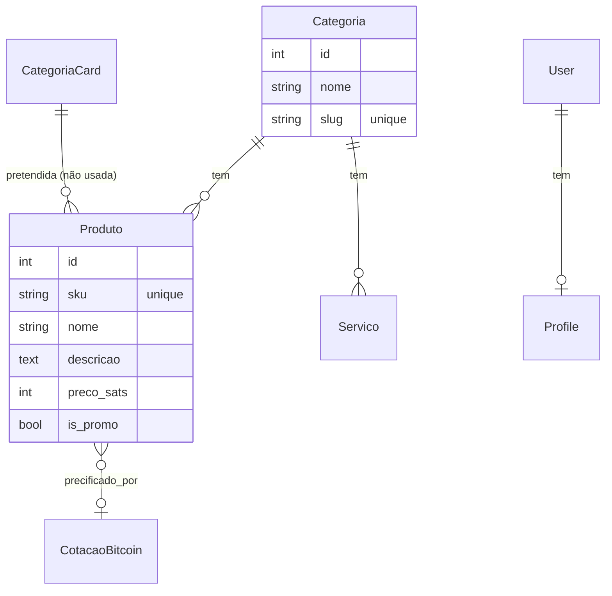

# Modelo de Dados

> 🇺🇸 [English](../DATA_MODEL.md)

Todos os models vivem em `core/models.py`. Esta página descreve cada model, seus campos
principais e o padrão singleton usado na configuração do site.

## Visão geral do ER

> A aresta `CategoriaCard → Produto` é **pretendida, mas quebrada**: `detalhe_categoria`
> tenta filtrar `Produto` por um `CategoriaCard`, mas `Produto.categoria` é FK para
> `Categoria`. Veja Arquitetura §9.

## Models de catálogo

### `Categoria`
- `nome` (CharField)
- `slug` (SlugField, unique)

Categorias de produto; o slug guia o filtro de `/categoria/<slug>/`.

### `MacroCategoria`
- `nome`, `slug` (unique), `ordem`, `ativo`

Macro-categorias "exibidas na vitrine principal". Atualmente definidas, mas não
renderizadas por `index.html` (o template usa `CategoriaCard` para os tiles).

### `CategoriaCard`
- `titulo`, `slug` (unique), `imagem_fundo` (ImageField), `ordem`

Os tiles de categoria realmente renderizados na home.

### `Produto`
- `sku` (unique, nullable) — usado como chave do carrinho e na URL de detalhe
- `nome`, `descricao`
- `categoria` (FK → `Categoria`, SET_NULL)
- `icone` (emoji fallback quando não há imagem)
- `preco_sats` (IntegerField) — **o preço canônico**, em satoshis
- `imagem` (ImageField, `produtos/`)
- `is_promo` — inclui nas "Ofertas Rápidas" (home, máx. 4)

Propriedades calculadas:

- `preco_brl` — preço fiduciário de referência a partir da última `CotacaoBitcoin`,
  fallback `0,005 BRL/sat`.
- `preco_pix_estatal` — `preco_brl × 1,1`.

### `CotacaoBitcoin`
- `preco_brl` (Decimal), `ultima_atualizacao` (DateTime)

Armazena a última cotação BTC/BRL. Atualizada por `views.home` quando ausente ou mais
antiga que 24 h; também lida por `context_processors.btc_context`.

### `Servico`
- `nome`, `descricao`, `categoria` (FK, nullable), `icone`, `imagem`, `is_promo`
- `whatsapp_ativo`, `telegram_ativo` — quais canais de contato o card oferece
- `mensagem_padrao` — mensagem de interesse pré-preenchida

Cards de assessoria/concierge. Eles **não** entram no carrinho; o interesse é enviado
via Telegram/WhatsApp.

## Model de autenticação

### `Profile`
- `user` (OneToOne → `auth.User`, CASCADE, `related_name='profile'`)
- `endereco` (Text), `telefone` (WhatsApp)

Criado automaticamente por sinais `post_save` em `User` (veja `models.py`). Editado via
`ProfileForm` em `/perfil/editar/`.

## Singletons de configuração

Cada um a seguir tem exatamente uma linha (`pk=1`), garantida por `save()`,
`get_solo()` e pelos guards de admin `has_add_permission()`/`has_delete_permission()`.

### `HomeConfig`
- `titulo_hero`, `subtitulo_hero`, `imagem_hero`, `ativo`

Banner hero da home.

### `SiteConfig`
O maior objeto de configuração. Grupos:
- **SEO/nomenclatura** — `logo`, `meta_title`, `nome_loja`
- **Badge** — `badge_ecossistema`, `badge_bg_color`, `badge_text_color`
- **Header** — `header_bg_color`, `header_text_color`, `sats_color`
- **Botões do carrinho** — textos e cores de limpar/pagar
- **Auth** — saudação, textos e cores de editar/sair/login
- **Banner** — `exibir_banner`, `exibir_cotacao`, textos e cores do banner

### `ConfiguracaoPix`
- `chave_pix`, `nome_titular`, `rotulo_taxa_pix`, `taxa_estatal_percentual` (padrão 10),
  `instrucao_pagamento`

### `ConfiguracaoTelegram`
- `bot_token`, `chat_id` (fallback para `.env`), `ativo`
- `titulo_form`, `texto_botao`, `mensagem_sucesso`, `mensagem_erro`

### `ConfiguracaoRodape`
- `descricao_curta`, `telefone_principal`, `outros_telefones`, `email_contato`,
  `endereco`, `site_principal`
- `facebook_url`, `instagram_url`, `youtube_url`, `x_url`

### `ConfiguracaoWhatsApp`
- `ativo`, `numero`, `mensagem_padrao` (fallback para `.env` por campo)

## Histórico de migrações

`core/migrations/` contém 24 migrações. A sequência é linear e reflete o histórico de
funcionalidades: `Produto` inicial → imagens/emoji → SKU/promo → `CotacaoBitcoin` →
`Categoria`/`Profile` → `HomeConfig` → `MacroCategoria` → `SiteConfig` (várias adições
de cores/textos) → `CategoriaCard` → `ConfiguracaoPix` → `ConfiguracaoRodape` +
`ConfiguracaoTelegram` → `ConfiguracaoWhatsApp` → `Servico` (e seu posterior refactor
de um único `canal` para `whatsapp_ativo`/`telegram_ativo`).
