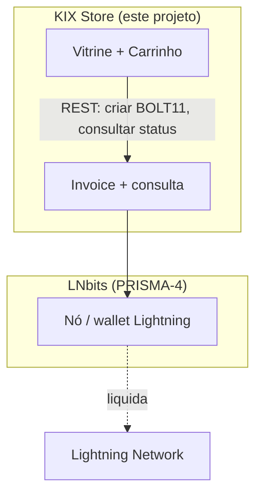

# Contexto do Protocolo KIX

> 🇺🇸 [English](../KIX_PROTOCOL.md)

A KIX Store é um front-end de comerciante construído sobre o
[Protocolo KIX](https://github.com/Hexarcs/KIX-PROTOCOL). Esta página explica o que é o
protocolo e como este projeto se encaixa nele. É um resumo da especificação upstream —
trate sempre o repositório do protocolo como fonte autoritativa.

## O que é o Protocolo KIX

O KIX é uma especificação aberta que reduz a carga de operar infraestrutura Lightning
Network, dividindo-a em camadas padronizadas e modulares. Seu framework organizador é o
**P.R.I.S.M.A.** — *Protocol Routing & Infrastructure Specification for Merchant
Applications* — que divide o stack em seis módulos:

| Camada | Nome | Responsabilidade |
|--------|------|------------------|
| PRISMA-1 | Execution Infrastructure & Host Profiles | hardware/SO, níveis de recursos |
| PRISMA-2 | Topology, Deployment & Network Exposure | Docker/Podman/bare-metal, Tor/túnel/clearnet |
| PRISMA-3 | Chain Source & Backend Sync | Bitcoin Core / Neutrino / Esplora / RPC |
| PRISMA-4 | Lightning Engine Abstraction | LND, CLN, Eclair, Phoenixd, **LNbits**, LDK, NWC |
| PRISMA-5 | Multi-Format Invoice Encoders | BOLT 11, BOLT 12, BIP 21, LNURL-Pay, Cashu |
| PRISMA-6 | Invoice Execution Profiles | execução HEAVY / HYBRID / LIGHT |

Um segundo conceito, **S.H.A.R.D.** (*Software Hardware Automated Routing Division*),
define a unidade física/operacional de um host (embarcado → edge → desktop → nuvem).

No topo da arquitetura do protocolo fica a **camada POS / wallet** (PDV, LNbits, Nostr
Wallet Connect, PWAs, dashboards), que se comunica via REST/WebSocket/MQTT descendo por
PRISMA-6 → PRISMA-5 → PRISMA-4 → PRISMA-3 → PRISMA-2 → PRISMA-1.

## Onde a KIX Store se encaixa

Esta app Django **é essa camada superior de POS/comerciante**. Ela deliberadamente não
roda um nó; consome uma engine Lightning via HTTP:

Mapeamento dos componentes deste projeto sobre o PRISMA:

| Componente da KIX Store | Camada PRISMA | Detalhe |
|-------------------------|---------------|---------|
| `generate_lightning_invoice` (chamada ao LNbits) | PRISMA-4 (abstração da engine) | delega a liquidação ao LNbits |
| BOLT 11 `payment_request` + QR | PRISMA-5 (codificação de invoice) | formato de invoice Lightning |
| Renderização de QR/consulta apenas no navegador | PRISMA-6 (perfil **LIGHT**) | a vitrine fica enxuta; o nó faz o trabalho pesado |
| Docker / Compose / bare-metal | PRISMA-2 | implantação e exposição |
| `LNBITS_URL` / `LNBITS_API_KEY` | config PRISMA-2/PRISMA-4 | endpoint da engine + auth |

## O desenho econômico (sats vs. PIX)

A loja codifica o incentivo do protocolo para liquidar nativamente via Lightning:

- **KIX nativo** — produtos são precificados em **sats**, liquidados via invoice
  Lightning. É o caminho mais barato e padrão.
- **PIX estatal** — a alternativa fiduciária precificada a partir da taxa BTC/BRL mais
  uma "taxa de processamento estatal" configurável (`taxa_estatal_percentual`, padrão
  `+10%`).

O spread de 10% é um sinal de preço deliberado: torna o caminho Lightning mais barato e
demonstra a tese da "economia real" — liquidar em sats evita o atrito/custo da via
fiduciária. A taxa exata e seu rótulo são editáveis em `ConfiguracaoPix`, então um
comerciante pode ajustar (ou neutralizar) o incentivo.

## Terminologia usada pela vitrine

| Termo | Significado neste projeto |
|-------|---------------------------|
| **sats / satoshis** | 1 sat = 1/100.000.000 BTC; a unidade-base de preço da loja |
| **Lightning Network** | liquidação Bitcoin de camada 2 usada no checkout nativo |
| **Invoice BOLT 11** | a string `payment_request` que o cliente escaneia/paga |
| **LNbits** | a engine/wallet Lightning que a loja chama via HTTP |
| **PIX estatal** | o trilho de pagamento instantâneo fiduciário do Brasil, usado como fallback |
| **taxa de processamento fiat** | a taxa configurável adicionada ao caminho PIX |

## Leitura complementar

- [Repositório do Protocolo KIX](https://github.com/Hexarcs/KIX-PROTOCOL) — a
  especificação autoritativa (PDFs em português e inglês).
- [API do LNbits](https://legend.lnbits.com/docs) — a engine integrada por esta loja.
- [BOLT 11](https://github.com/lightning/bolts/blob/master/11-payment-encoding.md) —
  o formato de invoice usado no checkout.
